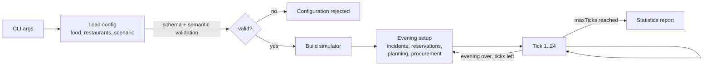

# Restaurant Simulation ("Saar la Carte")

A tick-based simulation of a group of restaurants over several evenings: reservations, seating and table
merging, waiters, kitchens with cooks and a pantry, delivery drivers, regular and casual customer groups,
events, incidents and ratings. Input is three JSON files (food, restaurants, scenario), output is a log of
everything that happens.

Group project of the **Software Engineering Lab (SoPra) 2026, Saarland University**: 5 students, design
phase plus 18-day implementation phase, Kotlin.

## Results (course grading server, final commit)

| Check | Result | Required |
|---|---|---|
| Mandatory system tests (validation 25/25, component 57/60, full 15/15) | **97 / 100** | 97 |
| Mutants caught by our own tests | **38 / 40** | 35 |
| Our system tests valid against the reference implementation | 433 / 436 | |
| Unit and integration tests (local) | 840, all passing | |

The course hides 40 deliberately broken versions of the reference implementation ("mutants"); a group's
system tests have to detect them.

## Architecture



Each tick runs six phases per open restaurant, in ascending restaurant id: arrivals, seating and ordering;
kitchen; serving; delivering; eating; escorting.

| Package | Responsibility |
|---|---|
| `config` | three-stage parsing (JSON schema, entities, cross-file rules), `Validator` |
| `simulation` | `Simulator`, clock, evenings and ticks, ratings |
| `foh` | front of the house: tables, waiters, reservations, delivery desk and drivers; `visit` holds the customer-visit state machine |
| `kitchen` | cooks, cook roster, pantry and supplier |
| `sharedPackage` | domain model: customer groups (regular, casual, event), orders, meals, food preferences |
| `incident` | staff, recipe, packaging and availability incidents |
| `logging` | every log message of the specification, with levels |

Design documents (PlantUML source and PDF) are in [`design/`](design): class diagram, simulation state
machine, parser sequence, first-tick preparation sequence and one scenario sequence.

## Team and contributions

| Member | Implementation | Testing |
|---|---|---|
| Ognjen Stojicic | simulation core, CLI and config loading, customer-visit state machine, seating, ordering, serving, escorting, event seating | features of Biborka and Constantin; many system tests (delivery, incidents, kitchen) |
| Teodor Vasilev | logging, food parsing, tables and merging, waiter assignment, incidents, event customers | features of Ognjen and Constantin; most mutant-killing system tests |
| **Stefan Marinkov** | **scenario parsing (customers, incidents), cross-file `Validator`, customer-group model (regular, casual), customer decisions, food preferences, waiting and patience clocks, ratings** | **features of Ognjen and Teodor; system-test registration and a large share of the system tests** |
| Biborka Fancsali | restaurant parsing, supplier, pantry, cooking | features of Teodor and Stefan |
| Constantin Hartmann | statistics, menu, browsing, delivery | features of Biborka |

Each feature had one implementer and two testers who were not the implementer.

### My part (Stefan)

| Area | What I built |
|---|---|
| Scenario parsing | `ScenarioParser`, `CustomerGroupSerialiser`, `IncidentSerialiser` and their DTOs |
| Validation | `Validator` (JSON schema check, used by all three parsers); file-scope and cross-file rules for customers and incidents |
| Customer model | `CustomerGroup` hierarchy (regular, casual), `Customer`, `History`, `FoodPreference` |
| Behaviour | restaurant choice, waiting, eating and give-up clocks, ratings (`ratingFor`) |
| Testing | unit tests for logging, simulator, tables, waiters, ordering, serving, incidents; `SystemTestRegistration`; about 28% of the system-test code |

Characteristics of my part:

- **Template Method:** `ScenarioParser` fills the hooks of the shared `ConfigParser` pipeline (`readEntities`, `validateFileScope`)
- **Factory:** `CustomerGroupSerialiser` builds a regular, casual or event group from the type field
- **Polymorphism over conditionals:** abstract `CustomerGroup` (`ratingFor`, `visitsOn`, `expectedDishes`), one subclass per group type
- **DTO mapping:** JSON DTOs (kotlinx.serialization) kept apart from the domain model
- **Multi-stage validation:** JSON schema, then entity rules, then cross-file references (ingredients, dishes, restaurants)
- **Interval logic:** overlapping unavailability windows rejected; delivery and visiting ticks checked against opening windows
- **Discrete-time state:** per-tick waiting, eating and patience counters; fixed an off-by-one at the patience boundary
- **Testing:** unit, integration and system tests; boundary-value cases; mutation-driven system tests
- **Quality:** detekt clean with no suppressions; fixed bugs found while testing (log format, delivery lifecycle, packaging calculation, order timing)

## Build and run

Requires JDK 21.

```sh
./gradlew build            # compile, detekt, unit + integration tests
java -jar libs/selab.jar \
  --food src/systemtest/resources/example/food.json \
  --restaurants src/systemtest/resources/example/restaurants.json \
  --scenario src/systemtest/resources/example/scenario.json \
  --maxTicks 30 --logLevel IMPORTANT
```

The system tests (`src/systemtest`) need the course's system-test API, which is only available on the
course server; see the comment in `build.gradle.kts`. Everything else builds without it.

## Stack

Kotlin 2.4 (JVM 21), Gradle, kotlinx.serialization, json-sKema (JSON schema validation), kotlinx-cli,
JUnit 5 and Mockito, JaCoCo, detekt (strict, no suppressions allowed).

## Credits and notes

- The specification, the JSON schemas, the build setup and the system-test API were provided by the
  Software Engineering Chair, Saarland University. The specification is not included here.
- This repository is a single snapshot of the group repository; per-author history stays in the course
  GitLab. Contributions are listed above as reported to the course.
- Generative AI use was declared per member to the course. I used Claude Code to scan the course forum for
  clarifications, write and debug tests, and run the build tooling; every change was reviewed before commit.
